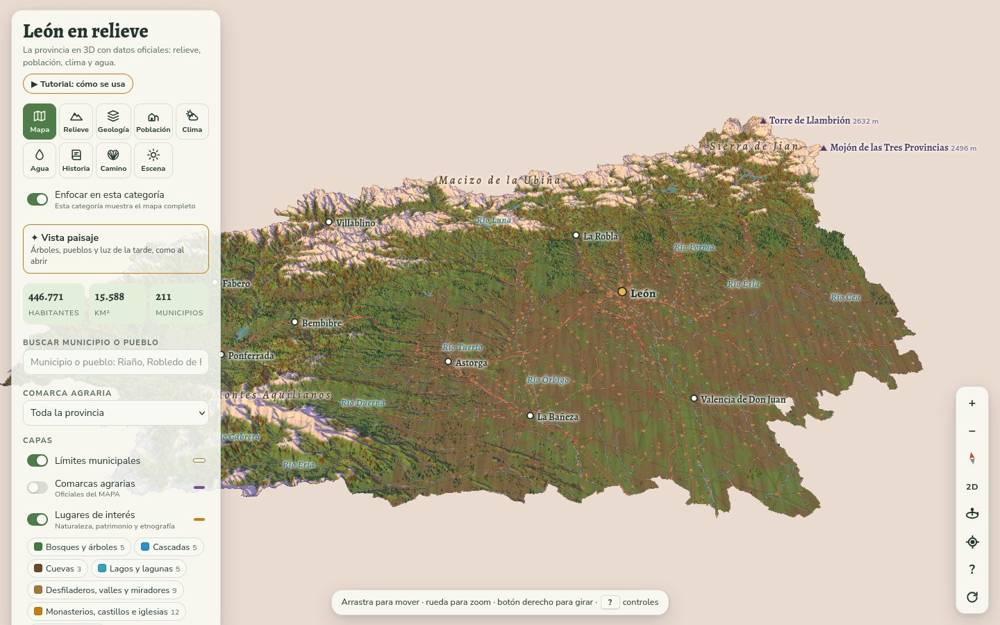
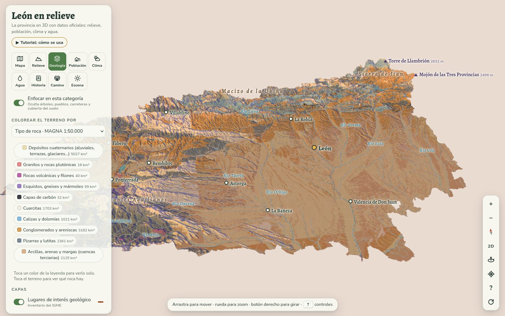
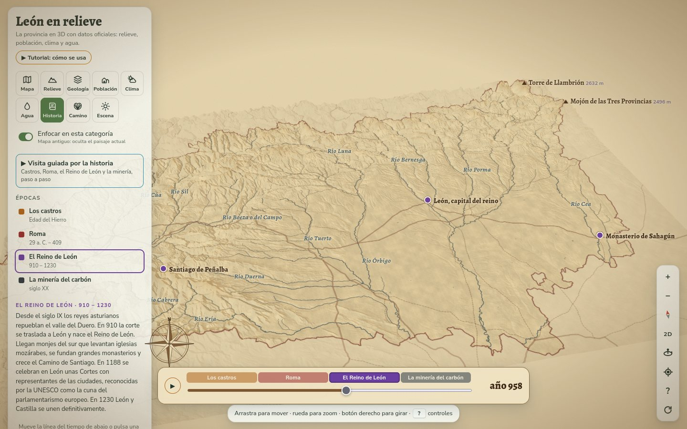
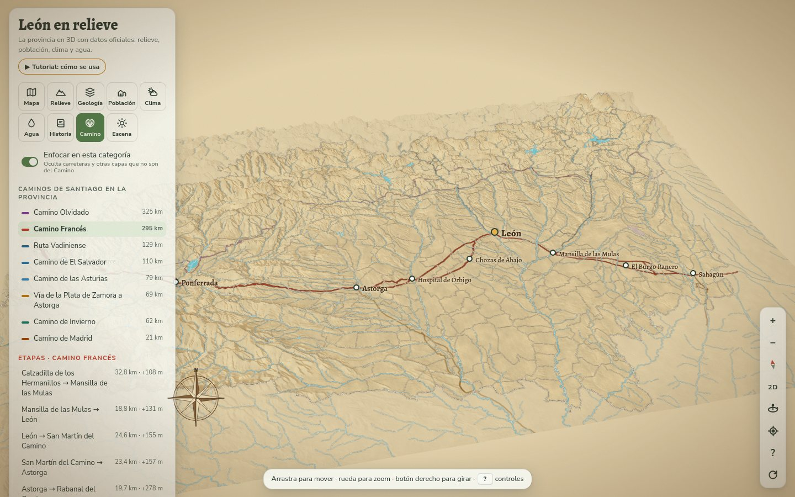

# León en relieve

Mapa 3D interactivo de la provincia de León con su orografía real, pintado con un estilo ilustrado y acogedor. Funciona en el navegador (HTML + [three.js](https://threejs.org/)), sin servidor de mapas ni teselas externas.

**Capas**: relieve (MDT25), límites municipales, comarcas, ríos, embalses y lagos, carreteras, poblaciones, cumbres, sierras, valles y puertos de montaña. Cada municipio tiene una ficha con su población (INE), superficie, altitudes y comarca. Se puede filtrar por comarca, cambiar la exageración vertical y la hora del sol, ver la evolución de la población de 1900 a 2025, transformar el relieve en un relieve de población y usar un mirador que calcula todo lo que se ve desde cualquier punto y dibuja su skyline: el panorama de 360° del horizonte, con capas de crestas, los nombres de las cumbres a la vista y descarga en PNG.

También tiene pestañas de **geología** (IGME), **clima** (normales de AEMET 1991-2020), **agua** (ríos, afluentes, caudales y embalses), **historia** (de los castros a la minería, sobre un mapa antiguo), **Camino de Santiago** (etapas, perfiles y albergues del IGN) **protección** (espacios naturales, Red Natura 2000, reservas de la biosfera y Bienes de Interés Cultural) e **incendios** (lo que ha ardido cada año desde 2016, con el verano de 2025 día a día), además de un tutorial guiado.

| | |
|---|---|
|  |  |
| **Paisaje** · relieve, pueblos, ríos y cumbres | **Geología** · tipos de roca del MAGNA 1:50.000 |
|  |  |
| **Historia** · línea del tiempo sobre un mapa antiguo | **Camino de Santiago** · caminos, etapas y albergues |

## Zonas: León y Picos de Europa

El mismo visor sirve para varias zonas. Cada una tiene su ficha en `web/zonas.json` (nombre, extensión del mapa, tamaño de celda, municipios, latitud del sol, exageración del relieve, textos y qué capas de datos tiene) y sus datos en `web/data/<zona>/`. Se elige con la dirección (`index.html?zona=picos`) o con el selector «Mapa» del panel; el visor recuerda la última.

| Zona | Qué abarca | Celda | Capas |
|---|---|---|---|
| `leon` (por defecto) | La provincia de León (196 × 135 km) | 100 m | todas |
| `picos` | Los 11 municipios con territorio en el Parque Nacional de los Picos de Europa (Asturias, Cantabria y León) y su entorno (64 × 47 km) | 30 m | todas; en lugar del Camino de Santiago, rutas de montaña, refugios, majadas y cables |

Las pestañas cuyas capas no tiene una zona no aparecen («datos» en su ficha). En Picos, la protección sale de las capas nacionales del MITECO (Espacios Naturales Protegidos y Red Natura 2000; no hay BIC, porque no existe una capa abierta común a las tres comunidades), y las rutas, de `scripts/rutas.py`: la red de carreteras, pistas y sendas del IGN, sus cables y los refugios y majadas del Nomenclátor. Cada ruta va por el camino más corto de esa red; las que darían un rodeo absurdo (la Ruta del Cares, Poncebos–Bulnes) no se dibujan, porque la red del IGN no tiene esas sendas. Los lugares de interés y el mapa histórico de cada zona se escogen a mano en `recursos/<zona>/`.

## Fuentes

Todos los datos proceden de fuentes oficiales españolas o europeas (Copernicus); la comarca tradicional que aparece en la ficha de cada municipio es el único dato no oficial:

| Capa | Fuente |
|---|---|
| Relieve | IGN · MDT25, WCS `servicios.idee.es/wcs-inspire/mdt` |
| Provincia, municipios y condominios | IGN · Unidades administrativas INSPIRE, WFS `www.ign.es/wfs-inspire/unidades-administrativas` |
| Ríos | IGN · Hidrografía INSPIRE, WFS `servicios.idee.es/wfs-inspire/hidrografia` |
| Embalses y lagos, carreteras | IGN · OGC API Features `api-features.idee.es` (`standingwater`, `roadlink`) |
| Localidades (incluidas las que no son municipio), cumbres, sierras, valles, puertos | IGN · Nomenclátor Geográfico Básico de España, WFS `www.ign.es/wfs-inspire/ngbe` (entidades singulares, núcleos, capitales de EATIM y entidades menores) |
| Población de cada pueblo | INE · Nomenclátor a 1 de enero de 2025 (entidades singulares), cruzado con el IGN por municipio y nombre |
| Población | INE · Padrón municipal a 1 de enero (tabla 2877) |
| Cubierta del suelo y bosques | Copernicus · CLC+ Backbone 2021 (10 m, 11 clases), servidor de imágenes de la Agencia Europea de Medio Ambiente (`image.discomap.eea.europa.eu`), reducido a 50 m por clase mayoritaria |
| Densidad de población | INE · Censo 2021, población en celdas de 1 km² de la rejilla europea (`Poblacion_Rejilla_Europea.csv`) |
| Población histórica | INE · Alteraciones de los municipios en los Censos de Población desde 1842 (población de derecho 1900–2021; a cada municipio actual se le suman los que absorbió) |
| El Bierzo | Ley 1/1991 de Castilla y León (38 municipios) |
| Comarcas agrarias | MAPA · `ComarcasAgrarias.shp` de la IDE del Ministerio de Agricultura (copia distribuida por [rOpenSpain/mapSpain](https://github.com/rOpenSpain/mapSpain)). Cada municipio va a la comarca con la que comparte más superficie |
| Comarca tradicional (dato secundario en la ficha) | Ficha de cada municipio en es.wikipedia.org, vía Wikidata (código INE P772). No es oficial |
| Clima (normales 1991-2020) | AEMET · rejilla diaria de 5 km ROCIO_IBEB (precipitación v2, temperaturas máxima y mínima v1); normales y ajuste con la altitud calculados por `scripts/clima_aemet.py` |
| Red de ríos y afluentes | IGN · red hidrográfica INSPIRE (HY-N) en la OGC API Features de la IDEE (`api-features.idee.es`) |
| Cuencas | Dirección General del Agua · cuencas de captación con orden Pfafstetter (superficie oficial); la sombra del visor es una aproximación sobre la red del IGN |
| Caudales y embalses | MITECO · Anuario de Aforos 2021-22 (Red Oficial de Estaciones de Aforo, datos de las confederaciones del Duero, Miño-Sil y Cantábrico); el caudal por tramo es una estimación calibrada con las estaciones |
| Geología | IGME-CSIC · MAGNA 1:50.000 (descripción y tipo de roca), Mapa Geológico de España 1:1.000.000 (edad, con los colores de la Comisión Internacional de Estratigrafía), Mapa Hidrogeológico 1:200.000 (permeabilidad) e Inventario Español de Lugares de Interés Geológico |
| Mapa histórico | Selección divulgativa de sitios y épocas (recursos/historia.json); calzadas romanas de Itiner-e 2024 (Zenodo, CC BY 4.0); labores de oro, minas de carbón y escombreras del IGME-CSIC; castillos, monasterios y yacimientos de Wikidata |
| Camino de Santiago | IGN · Caminos de Santiago en Europa (etapas y albergues, nco.ign.es); perfil y desnivel calculados con el MDT |
| Espacios naturales, Red Natura 2000 | Junta de Castilla y León · Red de Espacios Naturales (REN, con el Parque Nacional de Picos de Europa) y Red Natura 2000 (ZEC y ZEPA), datos abiertos de IDECyL (`opendata.jcyl.es`); fichas en patrimonionatural.org y en el formulario Natura 2000 de la Agencia Europea de Medio Ambiente |
| Reservas de la Biosfera | MITECO-OAPN · límites y zonificación de las Reservas de la Biosfera españolas (Banco de Datos de la Naturaleza) |
| Bienes de Interés Cultural | Junta de Castilla y León · BIC inmuebles declarados (recintos), datos abiertos de IDECyL; ficha de cada bien en el portal de Patrimonio Cultural |
| Incendios | EFFIS, Sistema Europeo de Información sobre Incendios Forestales (Copernicus, JRC de la Comisión Europea) · superficies quemadas por satélite desde 2016 (WFS `maps.effis.emergency.copernicus.eu`, capa `modis.ba.poly`), con la cubierta quemada según CORINE; pueblos afectados con el Nomenclátor del IGN |

## Como app en el móvil

`servidor/servidor.py` sirve `web/` como aplicación instalable (icono en la pantalla de inicio, pantalla completa) y añade el botón ↻ para cargar cambios y el guardado de lugares destacados. `servidor/leon3d-visor.service` lo deja como servicio de usuario de systemd (puerto 8800). La ubicación del dispositivo solo funciona si la app se abre por https.

Para publicarlo sin servidor propio (Cloudflare Pages u otro alojamiento estático), `python3 scripts/publicar_pages.py` deja en `publicar/` (y `publicar.zip`) la app lista para subir, sin la lista privada de destacados: allí los destacados son efímeros, solo duran la visita.

Si se expone a Internet, se le puede poner usuario y contraseña: `python3 servidor/servidor.py --acceso USUARIO` (pide la contraseña) y reiniciar el servicio. Se guarda como hash en `~/.config/leon3d-visor/acceso.json`, fuera del repositorio. Quien entra por `/entrar` recibe una cookie de sesión válida un año; `/salir` la borra. Cambiar la contraseña cierra todas las sesiones; `--sin-acceso` vuelve a dejar el visor abierto.

## Licencias

El código de este repositorio se publica con licencia [MIT](LICENSE). Es un proyecto educativo y divulgativo.

Los datos no se guardan en el repositorio: se descargan de sus fuentes oficiales y se procesan con los scripts. Cada fuente conserva su licencia, y todas permiten reutilizar citando el origen:

- **IGN / CNIG** (relieve, límites, hidrografía, toponimia, carreteras): CC BY 4.0, © Instituto Geográfico Nacional.
- **INE** (población, censos, nomenclátor): reutilización libre citando la fuente (Ley 37/2007).
- **AEMET** (clima): reutilización libre, también comercial, citando a AEMET como fuente según su nota legal.
- **MITECO y Dirección General del Agua** (anuario de aforos, embalses, cuencas): reutilización libre citando la fuente (aviso legal del MITECO, Ley 37/2007 y Real Decreto 1495/2011).
- **MAPA** (comarcas agrarias): reutilización libre citando la fuente.
- **IGME-CSIC** (geología): reutilización libre citando la fuente.
- **Itiner-e** (calzadas romanas): CC BY 4.0, Brughmans, Pažout, de Soto y Bjerregaard Vahlstrup (2024).
- **Copernicus** (cubierta del suelo): acceso libre y gratuito, © Unión Europea, Copernicus Land Monitoring Service, Agencia Europea de Medio Ambiente.
- **Wikipedia / Wikidata** (comarca tradicional y posición de algunos lugares de interés): CC BY-SA 4.0 y CC0.

Quien publique los datos procesados (por ejemplo, el visor con `web/data/`) debe mantener estas atribuciones; el visor las muestra en «Fuentes oficiales».

## Cómo construirlo

Requisitos: `bash`, `curl`, `python3` con `numpy`, `scipy` y `Pillow`, y R con los paquetes `sf`, `terra`, `dplyr` y `jsonlite`. Todas las fuentes se descargan sin registro.

Todos los scripts trabajan con la zona de la variable `ZONA` (por defecto `leon`): leen de `raw/<zona>/` y escriben en `web/data/<zona>/`. Para Picos, por ejemplo: `ZONA=picos scripts/descargar_datos.sh`, `ZONA=picos Rscript R/10_preparar_web.R`… Los parámetros que cambian de una zona a otra (cuántas cumbres principales, umbrales de ríos y lagos, simplificación, comarcas o provincias, fuentes de protección) están en el apartado `procesado` de su ficha. En Picos, el Camino de Santiago se sustituye por `ZONA=picos python3 scripts/rutas.py` (rutas de la ficha, refugios, majadas y cables), y el clima de AEMET y las calzadas de Itiner-e se reutilizan de `raw/leon/` con un enlace.

```bash
scripts/descargar_datos.sh        # descarga todo en raw/<zona>/ (León: unos 300 MB; se puede relanzar); incluye R/03_admin.R
Rscript R/10_preparar_web.R       # genera web/data/<zona>/relieve.png y zona.json
Rscript scripts/cumbres.R         # todas las cumbres con nombre del IGN (unas 3.000), con altitud y aislamiento -> web/data/cumbres.json
Rscript R/11_rejilla_poblacion.R  # genera web/data/poblacion.png (Censo 2021 en celdas de 1 km²)
Rscript R/12_cobertura_copernicus.R  # descarga CLC+ Backbone y genera web/data/cobertura.png
scripts/descargar_clima_aemet.sh   # rejilla diaria de 5 km de AEMET, 1991-2020 (unos 800 MB)
python3 scripts/clima_aemet.py    # normales climáticas -> web/data/clima.png y clima.json
python3 scripts/rios_red_descargar.py  # red del IGN (HY-N), cuencas de la DGA y Anuario de Aforos (unos 200 MB)
python3 scripts/rios_red.py        # afluentes, caudales, estaciones, embalses -> web/data/rios.json y cuencas.png
python3 scripts/geologia_descargar.py  # geología del IGME-CSIC (MAGNA 50, mapa 1:1M, hidrogeológico, LIG) -> raw/geologia/
python3 scripts/geologia.py        # tipo de roca, edad, permeabilidad y lugares de interés -> web/data/geologia.*
python3 scripts/lugares.py         # lugares de interés de recursos/lugares.json, situados con el Nomenclátor del IGN o Wikidata
python3 scripts/historia.py        # mapa histórico: sitios de recursos/historia.json, calzadas (Itiner-e), oro y carbón (IGME), Wikidata
python3 scripts/camino.py          # Caminos de Santiago: etapas y albergues del IGN, perfiles con el MDT -> web/data/camino.json
scripts/descargar_proteccion.sh    # figuras de protección (Junta de CyL y MITECO) -> raw/<zona>/proteccion/
Rscript scripts/proteccion.R       # espacios naturales, Red Natura, reservas de la biosfera y BIC -> web/data/proteccion.json (paquetes sf y jsonlite)
scripts/descargar_incendios.sh     # perímetros de incendios de EFFIS (Copernicus) -> raw/<zona>/incendios/
Rscript scripts/incendios.R        # incendios desde 2016 recortados a la provincia -> web/data/incendios.json
./abrir_visor.sh                  # sirve web/ en http://127.0.0.1:8800 y abre el navegador (--parar para detenerlo)
```

Los servidores del IGN fallan a veces (errores 502 o respuestas cortadas). El script de descarga reintenta y salta lo que ya está completo, así que basta con volver a lanzarlo.

## Lugares destacados (opcional y privado)

Si existe `web/data/<zona>/destacados.json` con una lista de nombres del Nomenclátor, el visor los marca con un pilar de luz y los añade al panel. Ese fichero no se sube al repositorio. Hay un ejemplo en `web/destacados.ejemplo.json`:

```bash
cp web/destacados.ejemplo.json web/data/leon/destacados.json
```

## Estructura

```
web/zonas.json               ficha de cada zona (la leen el visor y los scripts)
scripts/zona.py, R/zona.R    zona de trabajo (variable ZONA) y rutas raw/<zona>/ y web/data/<zona>/
scripts/descargar_datos.sh   descarga de todas las fuentes
scripts/fetch_ogcapi.py      cliente paginado de la OGC API Features de la IDEE
scripts/ine_poblacion.py     padrón del INE
scripts/comarcas_wikipedia.py comarca tradicional de cada municipio
scripts/ine_censos.py        población histórica por municipio (censos del INE)
scripts/ine_nomenclator.py   población de cada pueblo (Nomenclátor del INE)
R/03_admin.R                 límites administrativos
R/10_preparar_web.R          rejilla de alturas, recortes, simplificación y JSON para la web
scripts/cumbres.R            todas las cumbres con nombre (las principales van en zona.json; el resto aparece al acercarse)
R/11_rejilla_poblacion.R     población del Censo 2021 por km² en la malla del visor
R/12_cobertura_copernicus.R  cubierta del suelo de Copernicus (CLC+ Backbone 2021)
scripts/clima_aemet.py       normales 1991-2020 de AEMET (temperaturas, precipitación, heladas, días de calor) ajustadas a la altitud
scripts/lugares.py           sitúa los lugares de interés (recursos/lugares.json): Nomenclátor del IGN, Wikidata o su pueblo
scripts/camino.py            caminos de Santiago por la provincia: etapas, perfiles y albergues (IGN)
scripts/descargar_proteccion.sh, scripts/proteccion.R   figuras de protección: espacios naturales, Red Natura 2000, biosfera y BIC
scripts/descargar_incendios.sh, scripts/incendios.R     grandes incendios por año desde 2016 (EFFIS-Copernicus)
scripts/historia.py          mapa histórico por épocas (castros, Roma, Reino de León, minería del carbón)
scripts/geologia.py          tipo de roca, edad de las rocas, permeabilidad y lugares de interés geológico (IGME-CSIC)
scripts/rios_red.py          árbol de afluentes, caudal medio estimado por tramo, estaciones de aforo, embalses y cuencas aproximadas
servidor/servidor.py         servidor de la app (iPhone): cabecera PWA, version.json y guardado de destacados
web/index.html               visor 3D
abrir_visor.sh               abre el visor en local (para un acceso directo del escritorio; icono en recursos/icono.svg)
pruebas/                     pruebas automáticas en Firefox (WebDriver BiDi)
```

## Mapas para juegos

`juegos/0ad/` genera mapas de escaramuza de León para 0 A.D. (gratuito y libre) con el relieve, los ríos, los bosques y las ciudades reales. Ver [juegos/0ad/README.md](juegos/0ad/README.md).

## Pendiente

- Especies arbóreas con el Mapa Forestal de España (MFE25, MITECO): Copernicus distingue coníferas, caducifolias y perennifolias, pero no especies. Su descarga tiene un captcha y hay que bajarla a mano.
- Datos de ríos y embalses en tiempo real (SAIH del Duero y del Miño-Sil): sus servidores usan la raíz de certificados de la FNMT.
